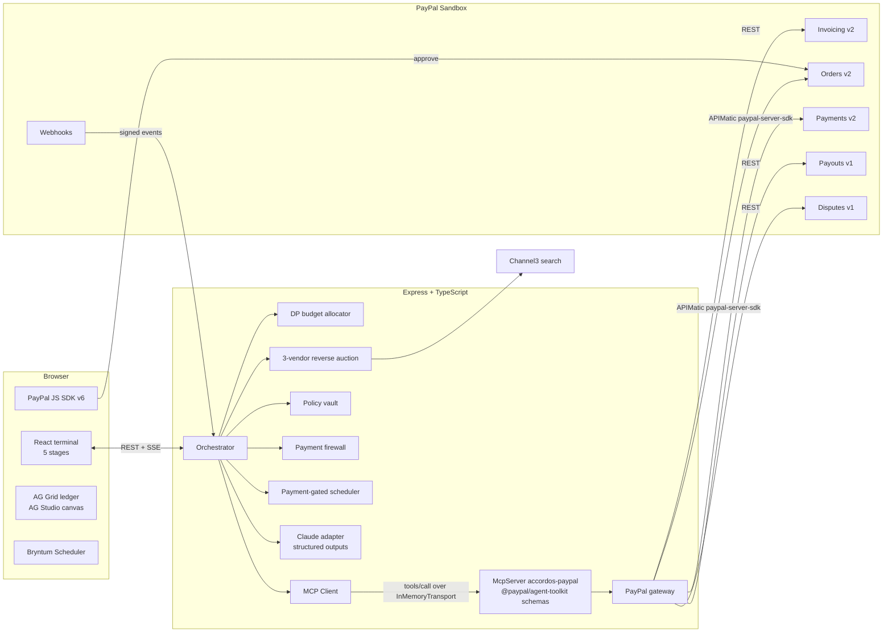
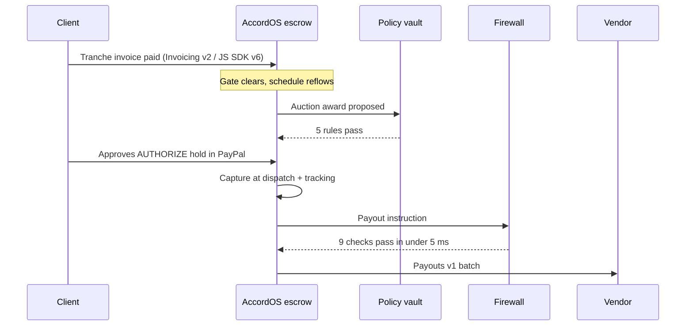
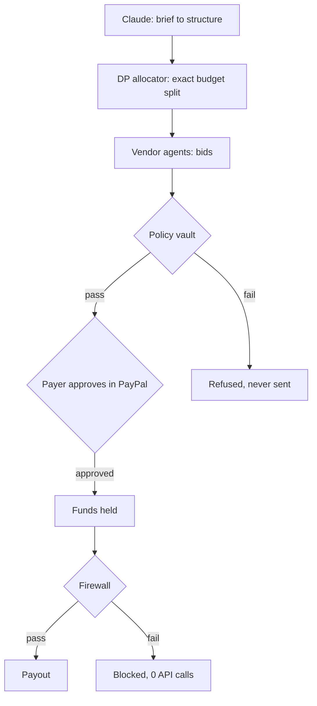

<h1><picture><source media="(prefers-color-scheme: dark)" srcset="web/public/brand/accordos-wordmark-dark.svg"></picture></h1>

**The commercial execution desk that runs a client project on PayPal: invoices in, supplier holds out, the schedule moving with every payment, and a firewall in front of every payout.**

The AI proposes. Deterministic code and a human dispose. Every cent is traced.

- **Sell side:** a client brief becomes PayPal Invoicing v2 tranche invoices with QR codes and early-payment terms.
- **Buy side:** Channel3 sourcing and a three-vendor reverse auction, with winners held through Orders v2 AUTHORIZE and captured at dispatch.
- **Delivery:** PayPal states gate the schedule, shown in a Gantt and a Bryntum Scheduler that reflow on webhooks.
- **Treasury:** an AG Grid chain-of-custody ledger, an AG Studio dashboard with a Claude-backed assistant, and firewall-gated Payouts.
- **Proof:** a red-team bench where eight payment attacks are blocked in under a millisecond each, with zero PayPal calls.

Every PayPal operation is an MCP tool call, using PayPal's own Agent Toolkit schemas, executed through the APIMatic SDK.

**Short on time? Press `Judge tour` in the header.** It walks through all five stages in about 30 seconds, doing one real action in each.

Built for the PayPal AI Hackathon 2026.

## Quick start

```bash
npm install
npm run build
npm start
```

Open http://localhost:8787. With no keys, the desk boots in **Replay** mode: a deterministic PayPal Sandbox simulator with a seeded project on every stage. Add keys to `.env` (see `.env.example`) for **Live Sandbox** mode. The green status strip at the top always shows each integration's mode: `Live on PayPal Sandbox` or `Replay mode`, `Claude reasoning` or `Deterministic rules`, and `Channel3 live catalog` or `Fixture catalog`. The moon icon in the header switches between the paper and charcoal themes.

`npm test` runs the end-to-end checks. `npm run dev` runs the API with hot reload on :8787 and Vite on :5173.

<details>
<summary>Configuration</summary>

| Variable | Effect when set |
| --- | --- |
| `PAYPAL_CLIENT_ID`, `PAYPAL_CLIENT_SECRET` | Live PayPal Sandbox for every money movement, JS SDK v6 checkout in the browser |
| `PAYPAL_SANDBOX_BUYER_EMAIL` | Invoice recipient (your sandbox personal account) |
| `PAYPAL_WEBHOOK_ID` | Webhook signature verification on `/api/webhooks/paypal` |
| `ANTHROPIC_API_KEY` | Claude parses briefs, maps finance questions to widgets, writes dispute statements and runs the AG Studio assistant |
| `ANTHROPIC_MODEL` | Claude model id (default `claude-sonnet-4-6`) |
| `CHANNEL3_API_KEY` | Live product search; otherwise a labelled fixture catalog is used |
| `MCP_ALLOW_EXTERNAL_WRITES` | Lets outside callers of `/api/mcp/call` run state-changing tools in live mode (off by default) |

</details>

---

## The problem

A small contractor fitting out an office juggles four systems that do not talk to each other: invoices to the client, purchase orders to suppliers, a delivery schedule, and payouts to crews. When a client pays late, a carrier slips or a supplier sends "updated bank details", a human has to notice and re-plan by hand. Money and schedule drift apart, and the business finds out at month end.

AccordOS puts the money and the schedule in one loop. PayPal states are the source of truth, and they are wired directly into the plan.

---

## The five stages

| Stage | What happens | PayPal surface |
| --- | --- | --- |
| **01 Tranche** | Claude parses the brief. A dynamic-programming allocator splits the budget across procurement, crew and contingency. Each milestone becomes a sent invoice with an early-payment rule and a scannable QR. The client pays through the JS SDK v6 checkout. | Invoicing v2 (create, send, QR, remind, record payment), Orders v2 CAPTURE, JS SDK v6 |
| **02 Bake-Off** | Each line item is sourced through Channel3, then three vendor agents with private cost floors bid against each other in rounds. A policy vault checks the award. The winner becomes an AUTHORIZE hold that the payer approves. | Orders v2 AUTHORIZE, Payments v2 capture and void, Shipment Tracking |
| **03 Schedule** | A payment-gated dependency Gantt plus a Bryntum Scheduler of crew, carrier and treasury bookings. Tasks cannot start until their gate clears: invoice paid, hold authorized, funds captured at dispatch. Webhooks and carrier events reflow the plan and the operations agent explains every move. | Webhooks (`INVOICING.INVOICE.PAID`, `CHECKOUT.ORDER.APPROVED`, `CUSTOMER.DISPUTE.CREATED`) |
| **04 Ledger** | An AG Grid chain-of-custody ledger, from client to escrow to vendor, with inline Capture, Void, Remind and Dispute actions. A prompt bar spawns live widgets: Anomaly Radar, Margin Cliff Calculator, Unpaid Invoice Nudge Scoreboard. An AG Studio canvas lets analysts build their own reports over the same live data. Firewall-gated payouts close the loop. | Payouts v1, Invoicing remind |
| **05 Red-Team** | Fire nine payment instructions at the production firewall: eight attacks and one clean control. A Dispute Defense agent assembles evidence and submits it. | Disputes v1 provide-evidence |

---

## Architecture



### Where a dollar goes



### What decides, and what only advises



Language models only turn text into structure: briefs into plans, questions into widget specs, evidence into a statement. Every decision that moves money is made by deterministic code you can read, and above $5,000 by a human in the PayPal approval window.

---

## How each technology is used

### PayPal Developer Platform

| Capability | Endpoint | Code |
| --- | --- | --- |
| Create, send, read invoice | `POST /v2/invoicing/invoices`, `/send`, `GET` | `server/src/paypal/gateway.ts` |
| Invoice QR code | `POST /v2/invoicing/invoices/{id}/generate-qr-code` | same |
| Reminder | `POST /v2/invoicing/invoices/{id}/remind` | same |
| Record payment | `POST /v2/invoicing/invoices/{id}/payments` | same |
| Create order (AUTHORIZE and CAPTURE) | `OrdersController.createOrder` | `server/src/paypal/sdk.ts` |
| Authorize, capture order | `OrdersController.authorizeOrder`, `captureOrder` | same |
| Capture, void authorization | `PaymentsController.captureAuthorizedPayment`, `voidPayment` | same |
| Shipment tracking | `OrdersController.createOrderTracking` | same |
| Payouts | `POST /v1/payments/payouts` | `server/src/paypal/gateway.ts` |
| Disputes | `GET /v1/customer/disputes`, `POST .../provide-evidence` | same |
| Webhook verification | `POST /v1/notifications/verify-webhook-signature` | same |
| Browser checkout | JS SDK v6 `createInstance`, `createPayPalOneTimePaymentSession` | `web/src/components/PayPalApprove.tsx` |

Every call is recorded in the telemetry drawer at the bottom of the screen: the MCP `tools/call` JSON-RPC frame, then the APIMatic SDK, REST or Replay call it caused, each with status, latency and the scrubbed request and response.

### Model Context Protocol

Every PayPal operation in AccordOS is an MCP tool call. The orchestrator never imports the PayPal layer directly:

```
orchestrator -> MCP Client -> InMemoryTransport -> McpServer "accordos-paypal" -> gateway -> APIMatic SDK / PayPal REST
```

- **Official tools** (`server/src/paypal/mcp.ts`). At boot, AccordOS starts the `PayPalAgentToolkit` MCP server from `@paypal/agent-toolkit`, lists its tools over a second in-memory transport, and serves 13 of them with PayPal's exact names, descriptions and JSON input schemas: `create_invoice`, `send_invoice`, `get_invoice`, `generate_invoice_qr_code`, `send_invoice_reminder`, `create_order`, `get_order`, `pay_order`, `create_shipment_tracking`, `get_shipment_tracking`, `list_disputes`, `get_dispute` and `accept_dispute_claim`. Each has `_meta.source = "@paypal/agent-toolkit"` and is executed by the AccordOS gateway, so Replay mode, telemetry and the APIMatic SDK all keep working.
- **Extension tools.** Seven operations the toolkit does not cover are prefixed `accordos_`: AUTHORIZE orders, authorize, capture and void an authorization, record an invoice payment, payouts, and dispute evidence.
- **HTTP access.** `GET /api/mcp/tools` lists the catalog. `POST /api/mcp/call` accepts `{ name, arguments }` or a JSON-RPC 2.0 `tools/list` or `tools/call` request. `accordos_create_payout` is never callable from outside, because payouts must pass the firewall. In live mode, tools that change PayPal state are refused for outside callers unless `MCP_ALLOW_EXTERNAL_WRITES=true`.

### APIMatic

Orders v2 and Payments v2 run through `@paypal/paypal-server-sdk`, the PayPal Server SDK generated by APIMatic. The typed controllers, `CheckoutPaymentIntent` enum and `ApiError` handling are used directly. The telemetry drawer labels these calls `APIMATIC SDK` so the split between SDK and hand-written REST is visible.

### Channel3

`server/src/engine/channel3.ts` sends each brief line item to Channel3 product search with the brief's unit-price ceiling, normalises the results and picks the best-value SKU under the cap. The SKU is then the subject of the auction. Without a key, a fixture catalog is used and labelled as such in the UI.

### AG Grid and AG Studio

The Stage 04 ledger is AG Grid Community with a custom Quartz theme bound to the design tokens, React cell renderers for state tags and inline PayPal actions, row identity for live updates, and tooltips for overflow.

Under it, `web/src/components/StudioCanvas.tsx` embeds AG Studio (`ag-studio` and `ag-studio-react` 3.0.0):
- `<AgStudioProvider modules={[AgStudioAiModule]}>` wraps an `<AgStudio>` in edit mode.
- The canvas is themed with `studioTheme.withParams(...)` using the DESIGN.md tokens.
- It is bound to four live data sources: Ledger, Tranches, Holds and Payouts. Each has typed fields (currency, integer, text) and descriptions written for the AI.
- The data is rebuilt on every state version, so reports update as PayPal events land.
- It opens on a pre-built report, `web/src/components/studioReport.ts`, so the canvas is never empty. The report has KPI tiles for ledger volume, invoiced tranches, authorized holds and firewall-cleared payouts, a bar chart of dollar volume by money state, a donut of awarded holds by vendor, and a grid of milestone tranches with their early-pay amounts.
- The Studio Agent Framework is wired with `createAiHarness(api, { adapter, promptStarters })`, through the `ai` prop of `<AgStudio>`.
- **With an Anthropic key, Studio's own agents run on Claude.** `createStudioAdapter` sends each turn to `POST /api/studio/turn`. `server/src/engine/studioTurn.ts` translates Studio's conversation items, tools and JSON response formats into Anthropic messages, `tool_use` and `tool_result` blocks, and translates the reply back into AG-UI events. Studio's orchestrator can therefore call `view_page` and `delegate_to`, and hand work to Studio's widget-building agent, which can build any chart a user asks for. Each turn appears in telemetry as `CLAUDE /v1/messages (ag_studio)`. The endpoint is rate-limited to 60 turns per IP per 10 minutes. If the call fails or no key is set, the turn falls back to the zero-key adapter below.
- The zero-key `AgLlmAdapter`, in `web/src/components/studioAi.ts`, streams AG-UI events:
  - On the first turn it calls Studio's own tools: `rename_thread`, and the read-only `view_page`.
  - On the next turn it answers from live AccordOS state and the `view_page` result, as streamed markdown.
  - It offers five prompt starters: "Summarise this page", "Show holds by vendor", "Which tranches are unpaid?", "What did the firewall block?" and "Add a chart of payouts by receiver".
  - When a prompt asks for a chart, the adapter adds it to the canvas through the live Studio API. It reads `api.getState()`, appends the widget to the selected page with a full-width layout below the existing widgets, and writes the new report back immutably with `api.setState()`. It can add a `payouts-by-receiver` bar chart or a `holds-by-status` donut chart, and its reply names the widget it added. If the chart is already on the canvas, or the request is for a chart it doesn't know, nothing changes and the reply says so.
  - It never calls `delegate_to`, so Studio's widget agent is never invoked.

### Bryntum

`web/src/components/BryntumSchedulerView.tsx` renders the real Bryntum Scheduler (`@bryntum/scheduler`, installed as the trial alias, plus `@bryntum/scheduler-react`):
- **Resources:** the crews, the carrier, the procurement desk, the client and treasury.
- **Events:** the planner's tasks. A task waiting on a PayPal gate is red, the critical path is orange and the rest are blue.
- **Dependencies:** taken straight from the task graph.
- **Tooltips:** show each booking's payment gate.

When a webhook or carrier event reflows the plan on the server, the bookings shift in the Scheduler. Tasks that moved are outlined. The view is lazy-loaded inside an error boundary, so the custom dependency Gantt above it still works if the Scheduler cannot render.

### Claude

`server/src/engine/ai.ts` uses the Anthropic TypeScript SDK with structured outputs (Zod schemas) on `claude-sonnet-4-6` by default, or the model in `ANTHROPIC_MODEL`, for three jobs: parsing a brief into milestones and line items, mapping a finance question to a widget spec, and writing the seller statement for a dispute. Each has a deterministic fallback, and every call appears in telemetry.

### Deployment (Vercel and Render)

AccordOS ships with both [`vercel.json`](vercel.json) (`api/index.js` serverless entry + static Edge CDN for `dist/web`) and [`render.yaml`](render.yaml) (single persistent Node web service):

- **Vercel (`vercel --prod` or Git-connected import):**
  - Set `PAYPAL_CLIENT_ID`, `PAYPAL_CLIENT_SECRET`, `PAYPAL_SANDBOX_BUYER_EMAIL`, `ANTHROPIC_API_KEY`, `ANTHROPIC_MODEL` (`claude-sonnet-4-6`), and `CHANNEL3_API_KEY` in the Vercel project's Environment Variables.
  - Cold starts run a parallelized fast-boot seed (`ensureSeeded()`) inside the 60-second function limit and persist snapshots to `/tmp/accordos-snapshot.json` for warm invocations.
  - SSE (`/api/stream`) closes at the 60-second invocation cap and the browser reconnects. To cover the gap, the frontend (`web/src/lib/api.ts`) also refreshes state and telemetry from every `POST`/`DELETE` response.
  - Project state lives in each function instance's memory. Vercel usually keeps one warm instance for low-traffic demos, but if a request lands on a new instance, that instance seeds its own fresh project, so a viewer can briefly see a different state. Use Render for a single shared state during judging.
- **Render (`render.yaml`):**
  - Deploys a single always-on web service with `/api/health` checks so in-memory state and long-lived SSE streams stay in one process.
- **Both:** link-preview tags (`og:image`, `og:url`) become absolute at build time from the host's own URL; set `PUBLIC_URL` for a custom domain. The Node server gzips responses, caches fingerprinted bundles for a year, and serves a real 404 page for unknown paths.

---

## The engines

**DP budget allocator** (`server/src/engine/allocator.ts`). A multiple-choice knapsack: pick exactly one option per category so total cost fits the budget and total utility is maximal. It is exact at $50 resolution and explores about 14,000 states in roughly a millisecond.

**Reverse auction** (`server/src/engine/auction.ts`). Three vendor agents with different strategies, private cost floors and category specialties. Bids are scored on landed cost plus a delivery-delay penalty minus a reliability credit. The auction is deterministic, so every replay produces the same rounds.

**Policy vault** (`server/src/engine/policy.ts`). Five rules: within the procurement allocation, unit price under the brief ceiling, payee on the allowlist, no duplicate hold, and delivery inside schedule float. Awards over $5,000 are flagged for human approval.

**Payment firewall** (`server/src/engine/firewall.ts`). Nine checks on every outbound instruction:
1. Prompt injection in vendor text
2. Hidden unicode or encoded payloads
3. Bank or remittance redirection
4. Payee mismatch with the registered vendor
5. Lookalike payee domain
6. Currency switch
7. Amount above the award or the remaining allocation
8. Reused reference
9. Payments split to stay under the approval threshold

The checks are pure functions with no I/O. On the bench, all eight attacks are blocked, the clean control passes, the slowest instruction takes under 1 ms, and no PayPal calls are made.

**Payment-gated scheduler** (`server/src/engine/schedule.ts`). A forward pass for earliest starts with payment gates, a backward pass for slack and the critical path, and a diff of every change for the operations log.

---

## Verify it yourself

```bash
npm test
```

`npm test` simulates PayPal (`PAYPAL_REPLAY=1`) so routine runs never move Sandbox money; Claude and Channel3 still run live when their keys are set. `npm run test:live` runs the same checks against the PayPal Sandbox. It sends real Sandbox Payouts, so the business account needs a balance to cover them.

The self-test drives the whole desk end to end and asserts:
- the allocation is feasible
- tranches sum correctly
- paying a tranche never delays work
- holds can be authorized and captured with tracking
- a carrier delay propagates downstream
- a dispute can be opened, defended and resolved
- payouts are firewall-gated
- all eight attacks are blocked while the control passes, each in under 5 ms with no PayPal calls
- PayPal's official toolkit tools are served over MCP with their published schemas
- every PayPal call went through an MCP `tools/call` frame
- missing required arguments are rejected
- payouts cannot be called from outside the process
- the AG Studio adapter calls Studio's tools first, then answers from live state (`scripts/studio-adapter.test.ts`)
- PayPal retries (`scripts/paypal-retry.test.ts`, with injected network failures) never record an invoice payment twice or re-send a sent invoice, reuse the same `PayPal-Request-Id` on retry, retry payouts only when the connection never opened, and never retry 4xx business errors
- the Claude turn mapping (Studio items to Anthropic messages, tools and choice, then back to AG-UI events) and the adapter's fallback to local mode
- the adapter adds the payouts-by-receiver and holds-by-status widgets through `setState` without touching existing widgets, and makes no duplicate or unknown-chart writes

---

## Honest scope

- In Replay mode, PayPal responses are simulated with deterministic IDs and are labelled `REPLAY` everywhere. Live mode uses real Sandbox calls.
- **Live fast-forward.** An Orders v2 hold is only truly authorized after a buyer approves it in the PayPal popup. In live mode, approving without that popup (the **Fast-forward approvals** button, or the seed) makes PayPal return `422 ORDER_NOT_APPROVED`. AccordOS then simulates that one authorization:
  - It gets an `AUTH-` id, a **Fast-forwarded** tag, a `REPLAY` telemetry row and a "simulated" ledger memo.
  - Its capture and void are simulated too, as is its shipment tracking, because PayPal only accepts tracking against a real capture.
  - Payouts for it are still real Sandbox Payouts calls.
  - Any other PayPal error is shown as a failure, never fast-forwarded.
- On boot, the seed places holds, authorizes three and captures one, so disputes, payouts and the AG Studio KPIs work on first load. In live mode it places two real holds instead: it fast-forwards and captures the first, and leaves the second for a real popup approval.
- The PayPal Sandbox cannot create buyer disputes through the API. "Open dispute" uses a real open dispute from the account when one exists. Otherwise it creates a clearly marked simulated dispute (`PP-D-SIM-...`), whose evidence payload is built and replayed rather than sent.
- The MCP transport is in-process (`InMemoryTransport`), and `/api/mcp/call` speaks JSON-RPC over plain HTTP. It is not the MCP Streamable HTTP transport.
- PayPal's official `create_invoice` schema has no due-date field, so each tranche's due date and early-payment rule are written into the invoice note.
- AG Studio and Bryntum run as trials and show their trial watermark and console notice. Without an Anthropic key, the AG Studio assistant runs on a deterministic local adapter. It answers the AccordOS questions above and can add the two predefined charts, but it does not design new widgets from free-form requests. With a key, Claude drives Studio's own agents.
- Bryntum's trial package runs an obfuscated `postinstall` script. It is not needed at runtime, and npm's script approval blocks it by default.
- The dependency Gantt in Stage 03 is a custom React and SVG component. The Bryntum Scheduler sits beside it.
- The early-payment discount is enforced by AccordOS and stated in the invoice terms. PayPal invoices have no native conditional discount.
- **Channel3 latency.** Searches usually take 2-6 s but sometimes exceed 10 s. Each search gets 12 s and one retry. If both fail, the item reuses its last live Channel3 results, which are kept in the OS temp folder so they survive restarts and Vercel warm starts. The fixture catalog, labelled `Fixture`, appears only if Channel3 has never answered for that item.
- **`npm audit`.** The remaining advisories come from `@paypal/agent-toolkit` 1.11.0 (the latest release), not from AccordOS code:
  - Its LangChain, Vercel AI SDK and OpenAI integrations, and the packages beneath them, are never loaded: AccordOS imports only `@paypal/agent-toolkit/mcp` to read PayPal's tool schemas.
  - That entry does load mathjs, which `package.json` overrides to the patched 15.2.0. It also loads zod 3 to define its schemas; AccordOS validates its own input with zod 4.

---

## Project layout

```
server/src/
  index.ts            Express app, static hosting, seed on boot
  routes.ts           REST API, SSE stream, webhook endpoint
  orchestrator.ts     One function per operator action
  paypal/             mcp.ts (McpServer + Client), client.ts (orchestrator's MCP calls),
                      gateway.ts (live or replay), sdk.ts (APIMatic), rest.ts (OAuth, REST)
  engine/             allocator, auction, policy, firewall, schedule, channel3, ai, widgets, disputes
  selftest.ts         End-to-end checks
web/src/
  stages/             Tranche, BakeOff, Schedule, Ledger, RedTeam
  components/         Shell, PayPalApprove (JS SDK v6), StudioCanvas (AG Studio),
                      BryntumSchedulerView, ui (six-state Panel contract, ErrorBoundary)
DESIGN.md             Design system
DEMO_SCRIPT.md        Under-three-minute video script
```

## License

MIT. See [LICENSE](LICENSE).
